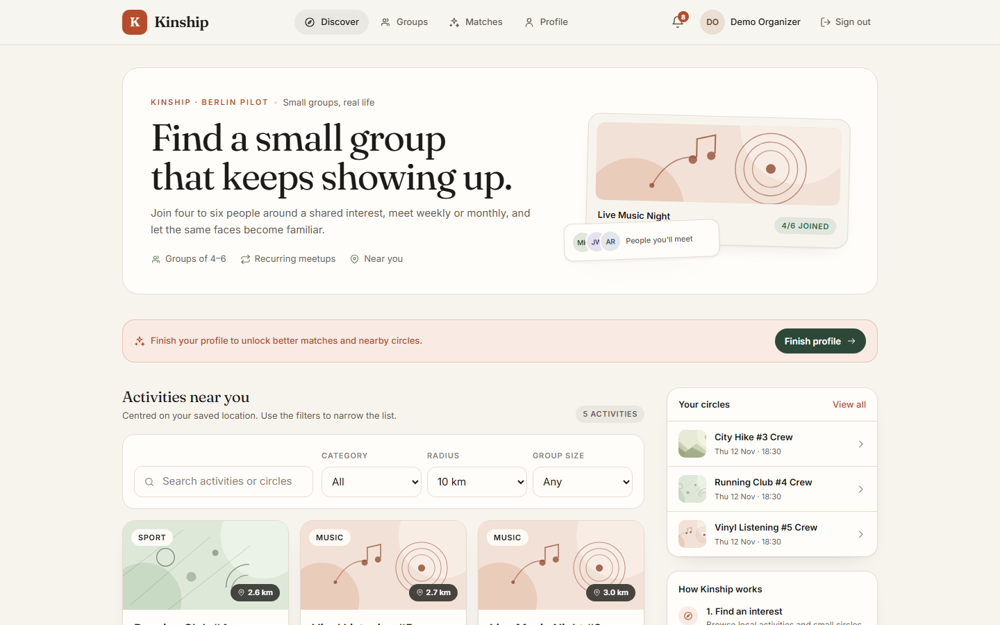
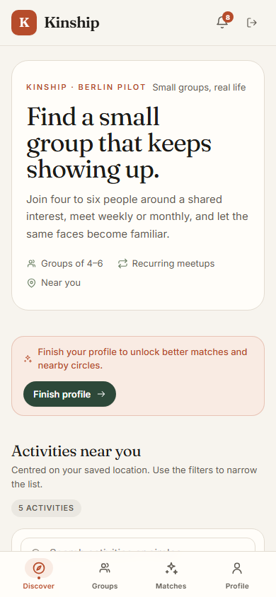
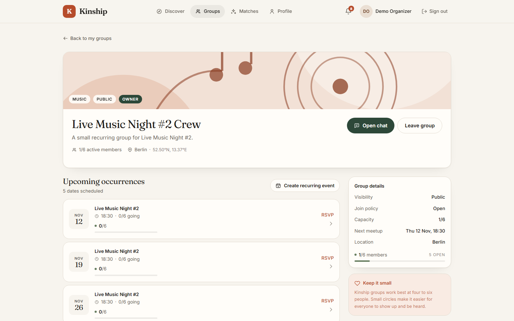
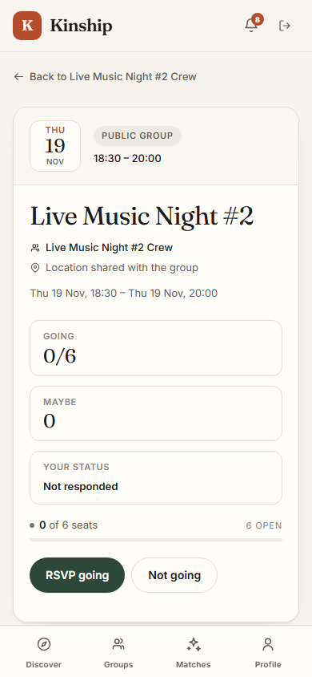
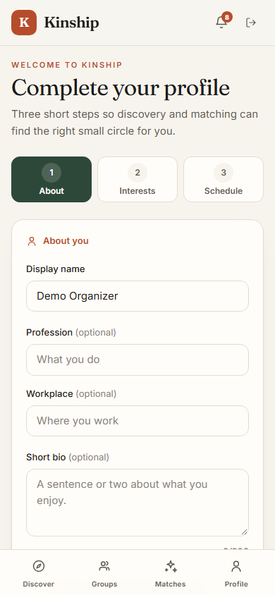
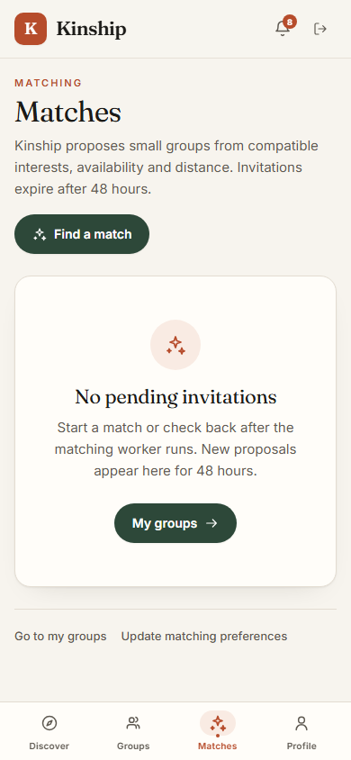
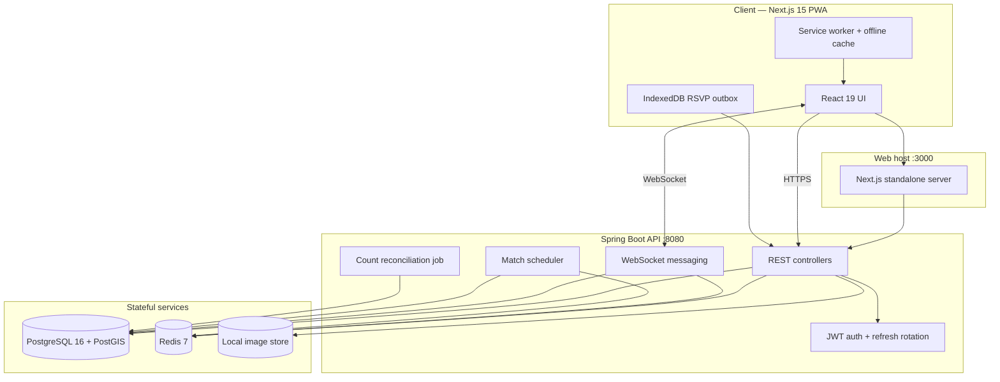

<div align="center">

# Kinship

**Small, recurring activity groups that turn neighbours into friends.**

[](https://github.com/bhaktaji/kinship/actions/workflows/ci.yml)
[](https://openjdk.org/)
[](https://spring.io/projects/spring-boot)
[](https://nextjs.org/)
[](https://react.dev/)
[](https://postgis.net/)
[](https://redis.io/)
[](https://web.dev/progressive-web-apps/)
[](#-testing--verification)

<br />

### **A friendship product, not another feed.**

*Discover an activity → join a circle of 4–6 people → meet on a recurring schedule → actually become friends.*

<br />

**[Get started locally](#-quick-start-docker-recommended)** · **[See the product](#-screenshots)** · **[How it works](#-architecture--technology-stack)**

</div>

---

## 📌 Executive Summary

Adults are busier and more mobile than ever, yet the places where friendships used to form — the workplace, the neighbourhood, the weekly club — have become thin and transient. Dating apps are built for romance. Social feeds are built for attention. One-off "meetup" events rarely survive past the first awkward evening.

**Kinship is built on a different premise: friendship is a by-product of repeated, low-pressure, in-person interaction around a shared activity.**

Kinship helps people find a small local group built around something they already enjoy — live music, running, board games, hiking, book clubs — and then gives that group the tools to keep showing up: recurring events, reliable RSVPs, and a private group chat.

```
   Discover an activity
            │
            ▼
   Join a small group (4–6 people)
            │
            ▼
   RSVP to recurring events
            │
            ▼
   Message the group
            │
            └──────────► show up again next week
```

The result is a product optimised for **real-world retention**, not screen time.

---

## 🖼 Screenshots

| Discovery — desktop | Discovery — mobile |
|---|---|
|  |  |

| Group detail — desktop | Event RSVP — mobile |
|---|---|
|  |  |

| Onboarding — mobile | Matches — mobile |
|---|---|
|  |  |

The interface is a warm, editorial "social club" design system — self-hosted Fraunces and Inter, terracotta and forest-green accents, and a mobile-first layout verified from 320 px to 1440 px.

---

## 💡 Why Kinship Is Different

| The usual pattern | The Kinship approach |
|---|---|
| **Swipe-and-ghost apps** optimised for engagement | **Small recurring circles** optimised for real-world attendance |
| **Large public events** where nobody connects | **Groups of 4–6** where every face is familiar |
| **One-off meetups** that fizzle after week one | **Weekly or monthly series** with generated occurrences |
| **Dating-app energy** applied to friendship | **Activity-first context** that removes the awkwardness |
| **Feed-first products** that keep you online | **In-person products** that get you off the phone |

### Who it is for

- **Newcomers** who have just moved to a city and know nobody.
- **Remote and hybrid workers** who miss the casual social contact of an office.
- **Empty nesters and retirees** rebuilding a local social life.
- **Hobbyists** who want a regular running crew, board-game table, or live-music group.
- **Anyone** who wants low-pressure, non-dating, in-person connection.

### Core benefits

- **Less intimidating** — four to six people, not a crowd.
- **Built for repetition** — recurring series create the familiarity friendship needs.
- **Shared context** — the activity does the ice-breaking.
- **Local by default** — PostGIS-powered discovery within a chosen radius.
- **Safe by design** — approval-based joining, private groups, member checks, and reporting.
- **Installable and resilient** — a PWA with offline discovery and a queued RSVP outbox.

---

## 📊 Product Status at a Glance

| Dimension | Status |
|---|---|
| Backend (P0–P7) | **Implemented and verified** — 25 unit + 18 integration tests |
| Frontend PWA | **Implemented and verified** — 16 Playwright end-to-end journeys |
| UI/UX redesign | **Complete** — responsive design system, six documented screenshots |
| Local deployment | **One-command Docker Compose stack** with healthchecks |
| Hosted public demo | **Not yet published** — run locally; see [Quick start](#-quick-start-docker-recommended) |
| Security | **First-party audit complete**; no independent penetration test yet |

> Kinship is a working full-stack reference implementation, not a production-readiness or security certification. See [Known limitations](#-known-limitations) and [`PROJECT_CLOSURE.md`](PROJECT_CLOSURE.md).

---

## ✨ Feature Matrix

| Feature | Category | Status | Implementation |
|---|---|---|---|
| **Authentication & sessions** | Identity | **Implemented** | Short-lived JWT access tokens, single-use rotating refresh cookies, logout, token-family revocation |
| **Profiles & onboarding** | Identity | **Implemented** | Display name, bio, profession, location, interests, availability; guided three-step onboarding |
| **Activity discovery** | Discovery | **Implemented** | PostGIS radius search, category/size filters, cursor pagination, ETag caching, Redis cache |
| **Groups** | Community | **Implemented** | Public/private circles, capacity limits, open or approval-based joining, member and owner controls |
| **Recurring events** | Scheduling | **Implemented** | Weekly/monthly series, generated occurrences, seat capacity, atomic RSVP |
| **Group chat** | Messaging | **Implemented** | Persisted messages over WebSocket, reconnect and history backfill, duplicate protection |
| **Matching** | Growth | **Implemented** | Asynchronous match jobs, scored proposals, 48-hour invitations, accept/decline |
| **Notifications** | Engagement | **Implemented** | Persistent notifications, unread counts, mark-read and mark-all-read |
| **Reviews & reporting** | Trust | **Implemented** | Post-event and post-group reviews, reporting flows |
| **Images** | Media | **Implemented** | Authenticated upload/get/delete, 5 MB limit, jpg/png/webp/gif |
| **PWA & offline** | Mobile | **Implemented** | Installable manifest, service worker, offline page, IndexedDB RSVP outbox |
| **Responsive navigation** | UX | **Implemented** | Mobile bottom tabs, desktop top navigation, verified 320–1440 px |
| **Browser push notifications** | Engagement | **Planned** | Notifications currently use polling |
| **Object-storage media** | Infrastructure | **Planned** | Images currently use local disk storage |

---

## 🗺 User Journey

### 1. Discover and join

1. A new user registers and completes a short onboarding profile.
2. Discovery shows nearby activities, filtered by category, radius, and group size.
3. Opening an activity reveals its groups and the next scheduled occurrence.
4. The user joins instantly, or submits a join request when the group requires approval.

### 2. Show up, repeatedly

1. The group owner creates a weekly or monthly series.
2. Kinship generates the upcoming occurrences automatically.
3. Members RSVP *going*, *maybe*, or *not going*; capacity is enforced atomically.
4. A waiting-safe conflict response prevents overbooking under concurrent RSVPs.

### 3. Stay connected

1. Members chat in a private, persisted group room.
2. Reconnecting clients backfill missed messages.
3. Notifications surface new messages, members, join requests, events, and cancellations.
4. After an event, members can leave reviews and report problems.

---

## 🏗 Architecture & Technology Stack



### Technology breakdown

| Layer | Technology |
|---|---|
| **Backend** | Java 21, Spring Boot 3.3.13, Spring MVC, Spring Security, Spring JDBC, Flyway |
| **Database** | PostgreSQL 16 + PostGIS 3.4, `geography` points, keyset pagination |
| **Cache / sessions** | Redis 7 (Lettuce): refresh tokens, WebSocket tickets, rate limits, pub/sub |
| **Realtime** | Spring WebSocket, single-use tickets, Redis fan-out, heartbeat |
| **Frontend** | Next.js 15.5.29 (App Router), React 19, TypeScript 5.6, Tailwind CSS 3.4, TanStack Query 5 |
| **PWA** | Manifest, service worker, offline page, IndexedDB outbox |
| **Testing** | JUnit 5, AssertJ, Mockito, Spring Boot Test, Testcontainers, Playwright, k6 |
| **Local runtime** | Docker Compose (recommended) or native Java/Node/PostgreSQL/Redis |
| **CI** | GitHub Actions: backend verify, frontend lint/typecheck/build, Playwright E2E |

### Architecture principles

- **Modular monolith.** `auth`, `user`, `activity`, `group`, `event`, `match`, `messaging`, `notification`, `review`, `image`, and shared `common` modules.
- **No ORM.** Data access uses Spring `JdbcClient` with bound parameters.
- **Stateless API.** Access tokens are verified without a database read; only the WebSocket session registry and scheduled workers are in-process.
- **PostGIS discovery.** A bounding-box pre-filter plus `ST_DWithin` on `geography(Point, 4326)`.
- **Redis for ephemeral state.** Refresh-token hashes, WebSocket tickets, rate-limit counters, discovery cache, and group pub/sub fan-out.
- **Hardened containers.** The API and web images run as non-root users with healthchecks.

### Repository layout

```text
kinship/
├── api/                     Spring Boot API (Maven)
│   ├── src/main/java/       auth, user, activity, group, event, match, messaging, ...
│   ├── src/main/resources/  application.yml, logback, Flyway V1–V5
│   └── src/test/java/       unit tests and Testcontainers integration tests
├── web/                     Next.js 15 App Router PWA
│   ├── app/                 discovery, groups, activities, events, profile, ...
│   ├── components/          design-system primitives and feature cards
│   ├── lib/                 API client, auth context, formatting, outbox
│   ├── public/              fonts, icons, manifest, service worker, offline page
│   └── e2e/                 Playwright critical journeys (E1–E10)
├── infra/docker-compose.yml PostGIS, Redis, API, web
├── docs/                    architecture, API, schema, testing, performance, screenshots
├── scripts/                 Windows startup helper and maintenance scripts
├── perf/                    k6 load/soak/race scripts (generated results ignored)
├── .github/workflows/ci.yml CI pipeline
├── .env.example             safe local configuration template
└── README.md
```

---

## 🔒 Security, Privacy & Trust Model

Kinship is a social product, so safety is a product feature, not an afterthought.

| Surface | Protection |
|---|---|
| **Passwords** | Hashed with BCrypt; never logged or returned |
| **Access tokens** | Short-lived JWTs, verified without a database read |
| **Refresh tokens** | Opaque, hashed in Redis, single-use, rotated on every refresh |
| **Replay detection** | A replayed refresh token revokes the entire token family |
| **Authorization** | Explicit `requireVisible`, `requireMember`, and `requireOwner` checks |
| **WebSocket** | Single-use tickets, membership checks, heartbeat |
| **Browser hardening** | Strict CSP, `X-Content-Type-Options`, `X-Frame-Options`, `Referrer-Policy`, `Permissions-Policy` |
| **Service worker** | Never caches authenticated API responses; asserted by the E2E suite |
| **Containers** | API and web run as non-root users |
| **Secrets** | Only `.env.example` with placeholders is committed; real `.env`, logs, generated credentials, and uploads are ignored |

**What is not claimed:** this repository has not had an independent penetration test or a completed Java dependency CVE scan. See [`SECURITY_AUDIT.md`](SECURITY_AUDIT.md) for the first-party assessment and its explicitly untested areas.

---

## 🚀 Quick Start (Docker, recommended)

### Prerequisites

- Docker Desktop with WSL2 (Windows) or Docker Engine (macOS/Linux)
- At least 4 GB of memory available to Docker
- Free host ports: **3000** (web), **8080** (API), **5433** (PostgreSQL), **6379** (Redis)
- Git

### Run the stack

```powershell
git clone https://github.com/bhaktaji/kinship.git
cd kinship

# 1. Create your local environment file.
Copy-Item .env.example .env

# 2. Replace the JWT placeholder with a random secret of at least 32 characters.
#    Git Bash / WSL: openssl rand -base64 32
#    PowerShell:
$secret = [Convert]::ToBase64String((1..48 | ForEach-Object { Get-Random -Maximum 256 }))
(Get-Content .env) -replace '^KINSHIP_JWT_SECRET=.*', "KINSHIP_JWT_SECRET=$secret" | Set-Content .env

# 3. Build and start the stack.
docker compose --env-file .env -f infra/docker-compose.yml up --build
```

Open:

| Service | URL |
|---|---|
| **Web app** | <http://localhost:3000> |
| **API** | <http://localhost:8080> |
| **Swagger UI** | <http://localhost:8080/swagger-ui.html> |
| **Health** | <http://localhost:8080/healthz> |
| **Readiness** | <http://localhost:8080/readyz> |

The first start runs Flyway and seeds a demo city. The seeder skips if the database already contains activities.

### Windows one-click helper

`startup.bat` (which calls `scripts/startup.ps1`) is an optional convenience wrapper. It starts PostgreSQL and Redis in Docker, then runs the API and web app natively, reusing healthy services and writing logs to `logs/`. It never runs `docker compose down`, drops volumes, truncates tables, or resets data.

```powershell
.\startup.bat
```

---

## ⚙️ Environment Variables

Copy `.env.example` to `.env`. **Never commit `.env`.**

| Variable | Required | Default | Purpose |
|---|---|---|---|
| `KINSHIP_DB_NAME` | no | `kinship` | PostgreSQL database name |
| `KINSHIP_DB_USER` | no | `kinship` | PostgreSQL user |
| `KINSHIP_DB_PASSWORD` | no | `kinship` | PostgreSQL password (local placeholder) |
| `KINSHIP_DB_URL` | native only | `jdbc:postgresql://localhost:5432/kinship` | JDBC URL for a native API run |
| `KINSHIP_JWT_SECRET` | **yes** | — | HS256 secret, at least 32 characters |
| `KINSHIP_COOKIE_SECURE` | no | `false` | Set `true` behind HTTPS in production |
| `KINSHIP_CORS_ORIGINS` | no | `http://localhost:3000` | Comma-separated allowed browser origins |
| `KINSHIP_SEED` | no | `true` in Compose | Seed the demo city when the database is empty |
| `KINSHIP_REDIS_HOST` | native only | `localhost` | Redis host |
| `KINSHIP_REDIS_PORT` | native only | `6379` | Redis port |
| `KINSHIP_METRICS_TOKEN` | no | empty | Required header for `/actuator/prometheus`; empty returns 404 |
| `KINSHIP_RECONCILE_ENABLED` | no | `true` | Enable count-reconciliation job |
| `KINSHIP_RECONCILE_CRON` | no | `0 30 3 * * *` | Reconciliation schedule |
| `NEXT_PUBLIC_API_BASE_URL` | no | `http://localhost:8080` | API base URL baked into the web build |

The Compose stack maps PostgreSQL to host port **5433** to avoid colliding with a native PostgreSQL service on 5432.

---

## 🗄 Database, Migrations & Seed Data

- Flyway runs automatically when the API starts. Migrations live in `api/src/main/resources/db/migration/` (`V1`–`V5`).
- The schema uses PostgreSQL 16 + PostGIS 3.4. `V1__schema.sql` creates the `postgis` extension; do not point the API at a plain PostgreSQL image.
- `KINSHIP_SEED=true` inserts the demo city only when `activities` is empty: **50 activities, 10 groups, 5 recurring series**, and the demo organizer.
- Seed data is deterministic, including the demo group/event identifiers used by the E2E suite.

### Reset the local database

Recreate the database rather than truncating individual tables.

```powershell
docker compose --env-file .env -f infra/docker-compose.yml down -v
docker compose --env-file .env -f infra/docker-compose.yml up --build
```

For a native database, drop and recreate it, then let Flyway and the seeder run again. **Do not truncate individual tables**; foreign keys and seed invariants depend on a clean rebuild.

---

## 🐳 Docker Development Workflow

```powershell
# Start or update in the background.
docker compose --env-file .env -f infra/docker-compose.yml up -d --build

# Follow logs.
docker compose --env-file .env -f infra/docker-compose.yml logs -f api web

# Show service status.
docker compose --env-file .env -f infra/docker-compose.yml ps

# Stop containers but keep the database volume.
docker compose --env-file .env -f infra/docker-compose.yml down

# Rebuild only the web image after frontend changes.
docker compose --env-file .env -f infra/docker-compose.yml build web
docker compose --env-file .env -f infra/docker-compose.yml up -d web
```

Compose healthchecks gate startup: the web container waits for the API, and the API waits for PostgreSQL and Redis.

---

## 🧑‍💻 Running Backend and Frontend Independently

Use this workflow for hot reload or a debugger. Start PostgreSQL and Redis first:

```powershell
docker compose --env-file .env -f infra/docker-compose.yml up -d postgres redis
```

### Backend

```powershell
$env:KINSHIP_DB_URL = "jdbc:postgresql://localhost:5433/kinship"
$env:KINSHIP_DB_USER = "kinship"
$env:KINSHIP_DB_PASSWORD = "kinship"
$env:KINSHIP_REDIS_HOST = "localhost"
$env:KINSHIP_REDIS_PORT = "6379"
$env:KINSHIP_JWT_SECRET = "<at least 32 random characters>"
$env:KINSHIP_SEED = "true"

cd api
mvn spring-boot:run
```

The API listens on <http://localhost:8080>.

### Frontend

```powershell
cd web
npm ci
$env:NEXT_PUBLIC_API_BASE_URL = "http://localhost:8080"
npm run dev
```

The web app listens on <http://localhost:3000> and proxies nothing: the browser calls the API directly, so `KINSHIP_CORS_ORIGINS` must include the web origin.

---

## 🧪 Testing & Verification

### Backend: unit + integration

```powershell
cd api
mvn -B -ntp verify
```

This runs JUnit 5 unit tests and Testcontainers integration tests against `postgis/postgis:16-3.4` and `redis:7-alpine`. Integration tests require a running Docker engine; they are skipped when Docker is unavailable.

**Verified result:** 25 unit + 18 integration tests, 0 failures, 0 errors, 0 skipped.

### Frontend: lint, typecheck, production build

```powershell
cd web
npm ci
npm run lint
npm run typecheck
npm run build
```

**Verified result:** lint 0 warnings/errors, typecheck pass, production build pass.

### End-to-end: Playwright

Start the full stack first, then:

```powershell
cd web
npx playwright install chromium
$env:E2E_NO_SERVER = "1"
npx playwright test
```

On macOS/Linux:

```bash
cd web
npx playwright install chromium
E2E_NO_SERVER=1 npx playwright test
```

**Verified result:** 16/16 journeys passed on a clean seeded database.

The suite runs serially because the tests share the seeded database. It covers registration and discovery, group join/RSVP, owner event creation, realtime messaging, matching, authorization, PWA offline behaviour, session rotation, group lifecycle, capacity races, and account isolation. Each test creates its own users and groups.

### CI

`.github/workflows/ci.yml` runs three jobs on pushes to `main` and pull requests:

1. Backend `mvn verify` (unit + Testcontainers integration).
2. Frontend `npm ci`, lint, typecheck, and production build.
3. Playwright E2E against the Docker Compose stack, with traces and logs uploaded on failure.

The workflow has only `contents: read` permission and uses no repository secrets. Its E2E JWT value is an ephemeral CI-only placeholder, not a production secret.

---

## 📦 Production Build

### Backend

```powershell
cd api
mvn -B -ntp -DskipTests package
java -jar target/kinship-api-0.1.0-SNAPSHOT.jar
```

Set `KINSHIP_JWT_SECRET`, database/Redis connection values, `KINSHIP_CORS_ORIGINS`, `KINSHIP_COOKIE_SECURE=true` (behind HTTPS), and a non-empty `KINSHIP_METRICS_TOKEN` if you scrape Prometheus.

### Frontend

```powershell
cd web
npm ci
$env:NEXT_PUBLIC_API_BASE_URL = "https://api.example.com"
npm run build
npm run start
```

`npm run start` serves the Next.js standalone output through `web/scripts/serve-standalone.mjs`; it is not `next start`.

### Containers

```powershell
docker compose --env-file .env -f infra/docker-compose.yml build
docker compose --env-file .env -f infra/docker-compose.yml up -d
```

The API and web images run as non-root users. The web image copies `public/` explicitly so the manifest, service worker, icons, fonts, and offline page are served in standalone mode.

---

## 🔑 Demo Credentials & Seed Data

The demo city is seeded only when `KINSHIP_SEED=true` and the database is empty:

| Field | Value |
|---|---|
| **Email** | `demo@kinship.local` |
| **Password** | `Demo12345!` |

The demo organizer owns the seeded "Live Music Night #2 Crew" group and its recurring events. These credentials are for local development only. Change or disable the demo seed before exposing an instance publicly.

---

## 🎨 UI Design System

The redesigned interface uses a warm editorial "social club" language:

- **Canvas:** warm paper `#F7F4EE`; surfaces `#FFFDF9`; ink `#1C1B18`.
- **Primary:** deep forest `#2D4839`; **brand accent:** terracotta `#B64C2B`.
- **Supporting:** sage `#687E60`, gold `#BC8B2C`.
- **Typography:** self-hosted **Fraunces** display serif and **Inter** UI sans in `web/public/fonts/`. Self-hosting keeps the CSP at `font-src 'self'`.
- **Tokens:** colours, type scale, radii, shadows, and motion are defined in `web/tailwind.config.ts` and `web/app/globals.css`.
- **Components:** buttons, fields, cards, pills, avatars, capacity meters, dialogs, skeletons, empty/error states, notification cards, activity/group cards, event rows, header, mobile bottom navigation, and offline banner.
- **Artwork:** category-specific inline SVG illustrations (`CategoryArt`) keep cards distinctive without external image dependencies.
- **Responsive:** mobile-first from 320 px, bottom tab bar below `md`, top navigation on desktop, collapsing grids, and a right rail only on large screens.
- **Theme:** light only. The original application did not support dark mode.

UI verification used Chromium at 320, 390, 768, 1024, and 1440 px across all signed-in routes, onboarding, and signed-out states. Every checked route had zero horizontal overflow and zero broken images.

---

## ⚡ Refresh Rate Limit: 30 → 120 Requests/Minute

`AuthController` limits `POST /v1/auth/refresh` to **120 requests per minute per client IP** (previously 30).

**Why it changed.** A full page load restores the session from the refresh cookie, and a user with several tabs, a shared NAT, or a reload-heavy development workflow can legitimately rotate tokens more often than 30 times a minute. The old limit produced `429` responses that looked like auth failures and made the E2E suite flaky. Refresh tokens remain single-use: each rotation atomically consumes the stored hash, and a replay revokes the token family.

**Production implications.**

- The limit is a burst/abuse guard, not an authentication control. Keep single-use rotation and family revocation as the primary protections.
- The bucket is per IP, so a large NAT or corporate proxy can still exhaust it. For a multi-tenant or NAT-heavy deployment, bucket per session/user at the edge or add a separate per-token limiter.
- 120/min is intentionally generous for a small consumer app. Tighten it only with a measured traffic profile and a user-facing retry path.
- Do not treat the limit as a substitute for a WAF, TLS, or monitoring.

---

## 🛠 Troubleshooting

| Symptom | Cause / fix |
|---|---|
| API exits with a JWT error | `KINSHIP_JWT_SECRET` is missing or shorter than 32 characters. Generate a new random value in `.env`. |
| `port is already allocated` | Another process uses 3000, 8080, 5433, or 6379. Stop it or change the host port mapping. |
| `type "geography" does not exist` | The database is not PostGIS-enabled. Use the `postgis/postgis:16-3.4` image or install PostGIS. |
| API healthy but discovery is empty | The seed is disabled or the database already has data. Set `KINSHIP_SEED=true` and use a fresh database. |
| `429` during discovery or refresh | Rate limits are working. Wait for the window, use separate test users, or clear local `rl:*` Redis keys **only in development**. |
| E2E fails after repeated runs | The shared database has accumulated test users/groups. Reset the Postgres volume with `down -v`, then start again. |
| Playwright cannot find Chromium | Run `npx playwright install chromium` inside `web/`. |
| Service worker serves stale UI | Hard-reload, clear site data, or unregister the worker in DevTools; `/sw.js` is served `no-store`. |
| `npm ci` fails on an old Node | Use Node 20 or 22. Next.js 15 requires Node 18.18 or newer. |
| Testcontainers tests are skipped | Docker is not running or is not reachable from Maven. Start Docker Desktop and rerun `mvn verify`. |
| `KINSHIP_DB_URL` connection refused on native run | Compose maps PostgreSQL to 5433; use `jdbc:postgresql://localhost:5433/kinship`. |

---

## 🗺 Roadmap

### Current release — P0–P7, verified locally

- [x] Authentication, profiles, and guided onboarding.
- [x] PostGIS activity discovery with filters and cursor pagination.
- [x] Groups with open or approval-based joining.
- [x] Recurring events, atomic RSVP, and capacity races.
- [x] Realtime group chat with reconnect and history backfill.
- [x] Matching, invitations, notifications, reviews, and reporting.
- [x] PWA with offline discovery and an IndexedDB RSVP outbox.
- [x] Responsive UI redesign and documented screenshots.
- [x] Docker Compose stack, CI pipeline, and Playwright E2E suite.

### Next milestones

- [ ] Publish a hosted demo with TLS termination and a reverse proxy.
- [ ] Add browser push notifications for events and messages.
- [ ] Move image storage to object storage (S3-compatible).
- [ ] Add slow-consumer isolation for WebSocket clients.
- [ ] Add dashboards, alerting, and a completed dependency CVE scan.
- [ ] Commission an independent security review and a 2-hour soak test.
- [ ] Optional: dark mode and localization.

---

## ⚠️ Known Limitations

- Single-host, HTTP-only local deployment; multi-host, TLS termination, proxy setup, and point-in-time recovery are not implemented.
- No independent security certification; the Java dependency CVE scan was not completed.
- Slow-consumer isolation for WebSocket clients is not implemented.
- Notifications use polling; browser push is not implemented.
- Images are stored on the local filesystem by default.
- The 2-hour soak target was not tested; a 20-minute soak passed.
- Alerting and dashboards are not configured.
- Dark mode is intentionally not implemented.
- `image_url` is not rendered; category artwork is used because seed images are null.

---

## 📚 Documentation

| Document | Purpose |
|---|---|
| [`docs/hld.md`](docs/hld.md) | High-level architecture, scope, NFRs, decisions |
| [`docs/lld.md`](docs/lld.md) | API contracts, auth/authz, algorithms, errors |
| [`docs/erd.md`](docs/erd.md) | Schema, enums, relationships, invariants |
| [`docs/testing_plan.md`](docs/testing_plan.md) | Test levels, scenarios, gates |
| [`docs/mobile_optimization.md`](docs/mobile_optimization.md) | PWA and frontend performance rules |
| [`docs/ci_integration.txt`](docs/ci_integration.txt) | Pipeline and quality gates |
| [`docs/perf/baseline.md`](docs/perf/baseline.md) | Load, soak, failure-injection results |
| [`SECURITY_AUDIT.md`](SECURITY_AUDIT.md) | First-party security assessment |
| [`PROJECT_CLOSURE.md`](PROJECT_CLOSURE.md) | Handover record and outstanding items |
| [`PHASE_1.md`](PHASE_1.md) … [`PHASE_7.md`](PHASE_7.md) | Phase evidence and reports |

---

## 📄 License

No license file is included in this repository. Choose and add a license before distributing the project.

---

<div align="center">

**Kinship — built for the kind of friendship that shows up again next week.**

</div>
